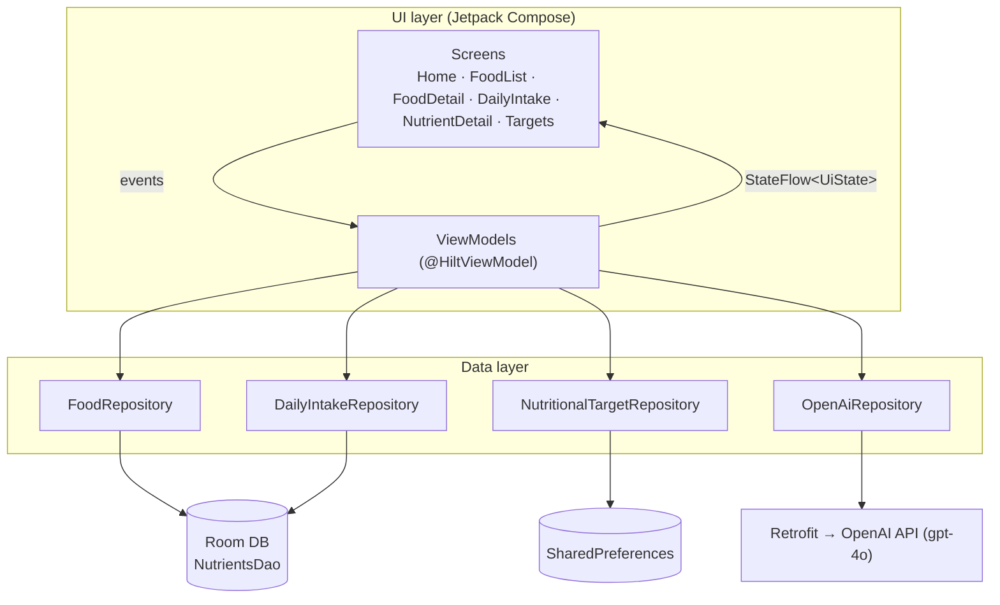

<div align="center">


# Nutrients AI Tracker

**An Android app that tracks your daily nutrient intake, using GPT-4o to read the nutrition facts for you.**


-3DDC84?logo=android&logoColor=white)


</div>

---

## Why

Food tracking apps are great until you have to type the nutrition values of every product by hand.
**Nutrients AI Tracker** removes that step: take a photo of the nutrition table on the package, or just type the
name of a food, and the app fills in the values for you with GPT-4o. You check them, save the food, and from then on
logging a meal is just "pick the food, enter the grams".

## Features

- 📸 **Read a nutrition table from a photo.** The picture is sent to GPT-4o (vision), which extracts energy, fat,
  saturated fat, carbohydrates, sugars, fiber, protein and salt per 100 g.
- ✍️ **Look up a food by name.** For fresh or unpackaged food, type its name and let the AI estimate typical values.
- 🗂️ **Personal food library.** Saved foods, each with an optional product photo, can be searched and edited later.
- 🍽️ **Daily log.** Add portions in grams; the nutrients are computed from the per-100 g values.
- 📊 **Daily summary with targets.** Progress bars show each nutrient against your goal, with the percentage reached.
- 🔍 **Nutrient breakdown.** Tap a nutrient to see which foods contributed to it that day.
- 📅 **History.** Move to any past day with a date picker.
- 🎯 **Custom targets.** Set your own daily goals for calories and each macro/micronutrient.
- 🔒 **Offline first.** All data stays on the device in a local Room database. The only network call is to OpenAI.

## Tech stack

| Area | Technology |
|---|---|
| Language | Kotlin 2.3 (coroutines, `Flow` / `StateFlow`) |
| UI | Jetpack Compose, Material 3, Navigation Compose |
| Architecture | MVVM with a repository layer, unidirectional data flow |
| Dependency injection | Hilt (Dagger) |
| Persistence | Room (with exported schemas), SharedPreferences for targets |
| Networking | Retrofit 3, OkHttp logging interceptor, Gson |
| AI | OpenAI Chat Completions API, `gpt-4o` with image input |
| Image handling | `ActivityResultContracts.TakePicture`, `FileProvider`, ExifInterface for orientation fixes |
| Build | Gradle Kotlin DSL, version catalog (`libs.versions.toml`), KSP, AGP 9 |
| Target | `minSdk 31`, `targetSdk 36` |

## Architecture



- **UI layer**: each screen has its own ViewModel exposing an immutable UI state as `StateFlow`. Composables are
  stateless where possible and only send events up.
- **Data layer**: repositories hide the data sources behind interfaces. Room entities (`Db*`) are mapped to domain
  models, so the UI never depends on the database schema.
- **AI integration**: `OpenAiRepository` builds a prompt that asks the model to return **only** a strict JSON object,
  then parses it into a typed `OpenAiFoodResponse`. Bad or incomplete answers are handled without crashing, and the
  user can always review and correct the values before saving.
- **DI**: a single Hilt `AppModule` provides the database, DAO, repositories, OkHttp and Retrofit as singletons.

### Project structure

```
app/src/main/java/dev/nanday/nutrients_ai_tracker/
├── data/
│   ├── local/          # Room database, DAO, entities
│   ├── remote/         # Retrofit client and OpenAI request/response models
│   ├── models/         # Domain models (Food, DailyIntake, Nutrient, NutritionalTargets)
│   └── *Repository.kt  # Repository interfaces and implementations
├── di/                 # Hilt modules
├── ui/                 # One package per screen (Screen + ViewModel), theme, shared components
└── utils/              # Date helpers
```

## Getting started

### Requirements

- Android Studio (a recent version that supports AGP 9)
- JDK 17 or newer (the one bundled with Android Studio works)
- An Android device or emulator running Android 12 (API 31) or newer
- An [OpenAI API key](https://platform.openai.com/api-keys) with access to `gpt-4o`

### 1. Clone the repository

```bash
git clone https://github.com/NandayDev/NutrientsAITracker.git
cd NutrientsAITracker
```

### 2. Add your OpenAI API key

The key is **not** in the repository. At build time Gradle reads it from `local.properties`, which is git-ignored,
and puts it into `BuildConfig.OPENAI_API_KEY`.

Copy the example file and edit it:

```bash
cp local.properties.example local.properties
```

```properties
# local.properties
sdk.dir=/path/to/your/Android/sdk   # usually added by Android Studio
OPENAI_API_KEY=sk-your-openai-api-key-here
```

You can also pass the key without the file, which is handy on CI:

```bash
OPENAI_API_KEY=sk-... ./gradlew assembleDebug
```

or as a Gradle property: `./gradlew assembleDebug -POPENAI_API_KEY=sk-...`

> If no key is found, the build still works but logs a warning, and the AI features return no results.

### 3. Build and run

From Android Studio, open the project, wait for the Gradle sync, then press **Run ▶**.

From the command line:

```bash
./gradlew installDebug
```

The debug build uses the application ID suffix `.debug`, so it can sit next to a release build on the same device.

## A note on API key security

This is a personal project, so the key is embedded in the app at build time for simplicity. This is fine for your
own device, but **you should not distribute an APK built this way**: anyone can extract a key from an APK.
In a production app, the OpenAI call would go through a small backend (or a serverless function) that keeps the key
on the server, adds authentication and rate limiting, and lets you rotate the key without a new app release.

## Roadmap ideas

- Move the OpenAI call to a backend proxy
- Unit tests for ViewModels and repositories, UI tests for the main flows
- Barcode scanning backed by an open food database
- Weekly and monthly charts
- English localization (the UI is currently in Italian)

## Author

**Guido Cardinali**: Android developer. [GitHub @NandayDev](https://github.com/NandayDev)
